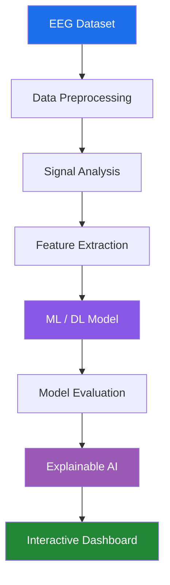

# 🧠 XAI Seizure Prediction Dashboard

### Explainable AI for EEG-Based Epileptic Seizure Prediction

An AI-powered research dashboard exploring epileptic seizure prediction using EEG signal analysis, machine learning, deep learning, and Explainable AI (XAI). The project focuses on making model predictions easier to interpret through interactive visualizations and feature attribution.

<p align="center">
  
  
  
  
  
  
</p>

<p align="center">
  <a href="https://github.com/arun-pandian-p/xai-seizure-prediction-dashboard">Repository</a> ·
  <a href="https://github.com/arun-pandian-p/xai-seizure-prediction-dashboard/issues">Issues</a> ·
  <a href="https://github.com/arun-pandian-p/xai-seizure-prediction-dashboard/blob/main/LICENSE">License</a>
</p>

---

## 📌 Overview

Epileptic seizure prediction is an important research area involving neurological signal processing and artificial intelligence.

This project explores how machine learning and deep learning techniques can analyze EEG signals to identify patterns associated with seizure activity.

It also incorporates Explainable AI techniques to investigate which input features contribute to model predictions.

### Project Objectives

- Analyze EEG signals and neurological patterns.
- Explore machine learning and deep learning approaches.
- Investigate seizure-related signal characteristics.
- Interpret model predictions using Explainable AI.
- Present analytical results through an interactive dashboard.

## ✨ Features

| Module | Description |
|---|---|
| EEG Signal Analysis | Explore and visualize EEG signal patterns. |
| Data Processing | Prepare EEG data for machine learning workflows. |
| Seizure Prediction | Apply trained models to seizure-related classification tasks. |
| Model Evaluation | Examine prediction performance and evaluation metrics. |
| Explainable AI | Explore feature importance and prediction explanations. |
| Interactive Dashboard | Present analytical results through visualizations. |

## 🛠️ Technology Stack

| Category | Technologies |
|---|---|
| Programming Language | Python |
| Machine Learning | Scikit-learn |
| Deep Learning | PyTorch |
| Dashboard | Streamlit |
| Explainable AI | SHAP / LIME (where implemented) |
| Data Processing | NumPy, Pandas |
| Visualization | Matplotlib, Seaborn, Plotly |
| Dataset | CHB-MIT Scalp EEG Database |

> The technology list should reflect the libraries and frameworks actually used in the repository.

## 🧠 AI Workflow

The general research workflow follows these stages:



### 1. EEG Data Processing
- Load and inspect EEG recordings.
- Prepare signal data for analysis.
- Apply appropriate preprocessing techniques.

### 2. Model Development
- Explore machine learning approaches.
- Experiment with deep learning architectures.
- Evaluate model predictions using suitable metrics.

### 3. Explainable AI
- Analyze feature contributions.
- Investigate prediction behavior.
- Visualize model explanations.

### 4. Dashboard Visualization
- Present EEG analysis results.
- Display model evaluation metrics.
- Explore prediction explanations interactively.

## 📂 Project Structure

```text
xai-seizure-prediction-dashboard/
│
├── frontend/              # Dashboard interface (if applicable)
├── backend/               # Application logic (if applicable)
├── models/                # Model implementations and artifacts
├── datasets/              # EEG dataset references / local data
├── analytics/             # Data analysis and evaluation
├── visualizations/        # Graphs and analytical outputs
├── docs/                  # Project documentation
│
├── requirements.txt       # Python dependencies
├── app.py                 # Application entry point (if applicable)
└── README.md
```

## ⚙️ Installation

### Prerequisites

- Python 3.10+
- Git
- pip

### 1. Clone the repository

```bash
git clone https://github.com/arun-pandian-p/xai-seizure-prediction-dashboard.git
```

### 2. Navigate to the project

```bash
cd xai-seizure-prediction-dashboard
```

### 3. Create a virtual environment

```bash
python -m venv venv
```

Activate it:

**Windows**
```bash
venv\Scripts\activate
```

**Linux / macOS**
```bash
source venv/bin/activate
```

### 4. Install dependencies

```bash
pip install -r requirements.txt
```

## ▶️ Running the Application

If the project entry point is `app.py` and uses Streamlit:

```bash
streamlit run app.py
```

Check the repository for the actual entry point and startup instructions.

## 📊 Model Evaluation

Model evaluation can include:

| Metric | Purpose |
|---|---|
| Accuracy | Overall classification performance |
| Precision | Proportion of positive predictions that are correct |
| Recall | Proportion of actual positive cases identified |
| F1-Score | Balance between precision and recall |
| Confusion Matrix | Breakdown of classification results |

For seizure-related research, recall and false-positive rates are particularly important considerations.

## 🔍 Explainable AI

Explainability is an important part of this project.

The objective is to understand how machine learning models arrive at their predictions.

Potential techniques include:

- **SHAP:** Feature contribution analysis.
- **LIME:** Local model prediction explanations.
- **Feature Importance:** Identifying influential input features.

Only techniques implemented in the project should be considered active features.

## 🗺️ Roadmap

- [ ] Improve EEG preprocessing pipeline.
- [ ] Experiment with additional ML/DL architectures.
- [ ] Improve model evaluation and validation.
- [ ] Integrate Explainable AI visualizations.
- [ ] Enhance interactive dashboard components.
- [ ] Explore real-time EEG data integration.
- [ ] Investigate model generalization across EEG recordings.

## ⚠️ Research Disclaimer

This project is intended for educational and research purposes only.

It is not a clinically validated medical device and must not be used to diagnose epilepsy, predict individual seizures for medical decisions, or replace professional neurological evaluation.

Model outputs are experimental and require appropriate clinical validation before any healthcare application.

## 🤝 Contributing

Contributions, suggestions, and improvements are welcome.

1. Fork the repository.
2. Create a feature branch.
3. Implement your changes.
4. Submit a pull request.

## 👨‍💻 Author

**Arun Pandian**

Full Stack Developer | AI & Data Science Graduate

- GitHub: [@arun-pandian-p](https://github.com/arun-pandian-p)
- LinkedIn: [Arun Pandian](https://linkedin.com/in/arun-pandian-developer/)
- Portfolio: [arunpandian.online](https://arunpandian.online)

## 📄 License

This project is licensed under the MIT License. See the [LICENSE](LICENSE) file for details.

---

<p align="center">
  <b>Making AI Predictions More Understandable.</b>
  <br/>
  If you find this project interesting, consider giving it a ⭐.
</p>
