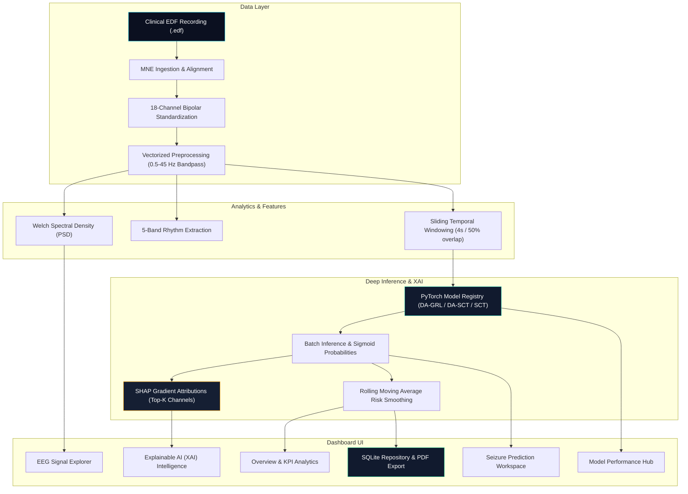

# 🧠 NeuroGuard XAI: Neurological EEG Analytics & Seizure Prediction Platform

<p align="center">
  
</p>

<p align="center">
  <strong>Enterprise Neurological Research Dashboard powered by Spiking ConvNet-Transformers, Domain Adversarial Neural Networks, and Explainable AI (XAI).</strong>
</p>

<p align="center">
  
  
  
  
  
  
</p>

---

## 📌 Executive Summary

**NeuroGuard XAI** is a research-grade EEG signal analytics and Explainable AI platform designed for high-integrity epileptic seizure detection. Built on the **CHB-MIT Scalp EEG Database** (Boston Children's Hospital), the application combines state-of-the-art Deep Learning models with model-specific SHAP gradient attribution and perturbation-based LIME surrogates.

### Primary Capabilities
- **Multi-Channel Waveform Explorer:** Standard 10-20 international bipolar montage viewer with interactive zoom/pan, Welch Power Spectral Density (PSD), 5-band rhythm decomposition, and 2D brain topography.
- **Deep Neural Inference Engine:** Sliding-window multi-model inference supporting **DA-GRL**, **DA-SCT**, **GRL**, **SCT**, and **Federated Learning** architectures with configurable decision thresholds.
- **Ground-Truth Clinical Validation:** Automated evaluation against clinical `.seizures` annotations with true-positive detection metrics and per-window accuracy.
- **Explainable AI (XAI) Biomarkers:** Model-specific gradient SHAP attribution and LIME surrogates identifying focal temporal electrode biomarkers (e.g. `C3-P3`, `P4-O2`, `P7-O1`).
- **Clinical Report Synthesis:** Automated export of Markdown and official formatted PDF clinical diagnostic summaries.

---

## 🎨 Healthcare SaaS Design System

The application has been overhauled from default Streamlit styling into a dark-navy medical technology design language inspired by modern clinical trial platforms and healthcare analytics dashboards:

| Token | Hex / Value | Purpose |
|---|---|---|
| **Background (Main)** | `#0B1020` | Dark navy platform canvas |
| **Secondary Surface** | `#111A2E` | Sidebar and active navigation surfaces |
| **Card Background** | `#151F33` | KPI containers, panels, and chart wrappers |
| **Primary Accent** | `#22D3EE` | Cyan highlights and active states |
| **Secondary Accent** | `#14B8A6` | Teal telemetry and frequency bands |
| **Text Primary** | `#F1F5F9` | High-contrast headers and values |
| **Text Muted** | `#94A3B8` | Contextual subtitles and axis labels |
| **Warning** | `#F59E0B` | Threshold markers and exploratory alerts |
| **Critical** | `#EF4444` | High-risk seizure detections and alerts |
| **Safe / Normal** | `#10B981` | Normal physiological baseline classification |

---

## 🏗️ System Architecture



---

## 📂 Repository Directory Layout

```text
xai-seizure-prediction-dashboard/
│
├── app.py                         # Streamlit application entry point (st.navigation)
│
├── pages/                         # Dedicated modular dashboard pages
│   ├── 01_Overview.py             # Executive KPI metrics & persistent session history
│   ├── 02_EEG_Explorer.py         # Multi-channel waveforms, spectral analysis, & topomaps
│   ├── 03_Seizure_Prediction.py   # Prediction workspace, threshold tuning, & report export
│   ├── 04_Model_Performance.py   # Empirical evaluation comparisons, radar, & ROC curves
│   ├── 05_Explainable_AI.py       # SHAP global/local attributions & LIME comparisons
│   └── 06_Research_Insights.py    # CHB-MIT cohort statistics & feature covariance
│
├── components/                    # Reusable UI component library
│   ├── __init__.py
│   ├── sidebar.py                 # Custom branded sidebar & active recording tracker
│   ├── header.py                  # Standardized healthcare SaaS header banner
│   ├── metric_cards.py            # Responsive KPI cards & status badges
│   ├── eeg_charts.py              # Interactive Plotly signal & spectral charts
│   └── prediction_cards.py        # Risk gauges, timeline trajectories, & summaries
│
├── src/                           # Core clinical application logic
│   ├── __init__.py
│   ├── data/
│   │   ├── __init__.py
│   │   ├── loader.py              # EDF loader & 18-channel bipolar alignment
│   │   └── preprocessing.py       # Butterworth filtering & Z-score normalization
│   ├── features/
│   │   ├── __init__.py
│   │   └── extraction.py          # Welch PSD & time-domain feature statistics
│   ├── prediction/
│   │   ├── __init__.py
│   │   ├── inference.py           # PyTorch sequence batch inference & caching
│   │   └── postprocessing.py      # Probability smoothing & interval computation
│   ├── evaluation/
│   │   ├── __init__.py
│   │   └── metrics.py             # Empirical benchmark metrics loader
│   ├── explainability/
│   │   ├── __init__.py
│   │   ├── shap_explainer.py      # SHAP DeepExplainer & GradientExplainer
│   │   └── lime_explainer.py      # LIME local surrogate artifact handler
│   ├── models.py                  # PyTorch neural network architectures (SCT, GRL, DASCT, DAGRL)
│   ├── database.py                # SQLite persistence (neuroguard.db)
│   └── report.py                  # PDF report generation (fpdf2)
│
├── models/                        # Pre-trained PyTorch model checkpoints (.pt)
│   ├── dagrl_model.pt             # Domain-Adversarial GRL model
│   ├── dasct_model.pt             # Domain-Adversarial Spiking Conv-Transformer
│   ├── grl_model.pt               # GRL model
│   ├── sct_model.pt               # Spiking Conv-Transformer
│   ├── federated_model.pt         # Federated learning checkpoint
│   └── model_best_xai_combined.pt # Best ensemble checkpoint
│
├── data/                          # Dataset access & clinical metadata
│   ├── README.md
│   ├── .gitkeep
│   ├── chb02_16+.edf             # Benchmark clinical EEG recording
│   ├── chb02_16+.edf.seizures    # Ground-truth clinical annotations
│   └── chb02_16_clean.seizures
│
├── analytics/                     # Research analytics & executive brief generator
│   ├── __init__.py
│   └── research_summary.py
│
├── utils/                         # Shared application utilities
│   ├── __init__.py
│   ├── config.py                  # Color constants & model registry
│   ├── logging.py                 # Structured logging handler
│   └── session.py                 # Persistent st.session_state handlers
│
├── assets/                        # Static UI design assets
│   ├── logo.png                   # High-resolution platform logo
│   └── styles.css                 # Dark-navy CSS design system
│
├── tests/                         # Automated unit & integration tests
│   ├── test_preprocessing.py      # Filter, normalization, and montage tests
│   ├── test_prediction.py         # Sequence preparation and postprocessing tests
│   └── test_explainability.py     # SHAP & LIME artifact tests
│
├── Documentation/                 # Research publications & thesis results
│   ├── result/                    # Empirical evaluation CSV and figures
│   │   ├── model_comparison.csv   # Exact benchmark metrics
│   │   └── ...                    # Saved training curves, ROCs, & XAI plots
│   └── IEEE_XAI_.pdf
│
├── .streamlit/
│   └── config.toml                # Custom dark-navy Streamlit theme configuration
│
├── requirements.txt               # Locked dependencies
├── pytest.ini                     # Pytest test configuration
├── README.md
├── LICENSE                        # MIT License
└── .python-version                # Python 3.12
```

---

## 📊 Empirical Benchmark Results

Evaluated on the **CHB-MIT Scalp EEG Database** across cross-validation folds:

| Architecture | Accuracy | Sensitivity (Recall) | Specificity | F1-Score | ROC AUC |
|---|---|---|---|---|---|
| **DA-GRL** | **99.77%** | **99.77%** | **99.77%** | **99.77%** | **0.99998** |
| **GRL** | 98.97% | 100.00% | 97.93% | 98.98% | 0.99964 |
| **SCT** | 98.56% | 98.28% | 98.85% | 98.56% | 0.99917 |
| **DA-SCT** | 98.28% | 98.28% | 98.28% | 98.28% | 0.99908 |

*Metrics derived from empirical test results in `Documentation/result/model_comparison.csv`.*

---

## 🚀 Quickstart Guide

### 1. Prerequisites
- Python 3.10 - 3.12
- Git

### 2. Environment Setup
```bash
# Clone the repository
git clone https://github.com/arun-pandian-p/xai-seizure-prediction-dashboard.git
cd xai-seizure-prediction-dashboard

# Create virtual environment
python -m venv .venv

# Activate virtual environment
# Windows (cmd/PowerShell):
.venv\Scripts\activate
# Linux/macOS:
source .venv/bin/activate

# Install dependencies
pip install -r requirements.txt
```

### 3. Launch the Application
```bash
streamlit run app.py
```
The dashboard will open automatically in your default browser at `http://localhost:8501`.

---

## 🧪 Running Automated Tests

Run the full automated test suite covering preprocessing, inference, and explainability:

```bash
pytest tests
```

---

## ⚠️ Medical & Research Disclaimer

> **IMPORTANT:** NeuroGuard XAI is developed strictly for **educational, academic, and scientific research investigations**. 
> - Deep learning model predictions and XAI attributions generated by this software **do not constitute clinical diagnoses** or medical advice.
> - This software has not received clearance or certification from the FDA, CE, or any regulatory medical authority.
> - It must not be deployed as a primary or autonomous diagnostic instrument for patient monitoring. Always consult board-certified neurologists for clinical evaluation.

---

## 📜 License

Distributed under the **MIT License**. See `LICENSE` for details.
